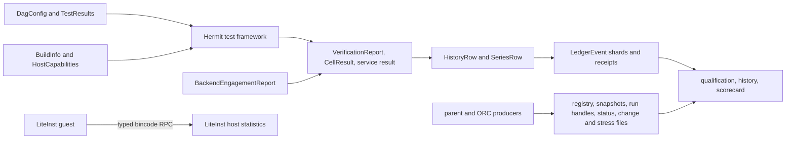

# Shared serialized types

This page lists the shared contracts that are written to disk or passed between processes. Sources are pinned to [Hermit `3b48f70e`](https://github.com/rrnewton/hermit/tree/3b48f70eeaf8d4f2edd8d85e56ef56526ac6cc0c), [dev-hermit `e9de940b`](https://github.com/rrnewton/dev-hermit/tree/e9de940b072b9150af4a21bec3bd6e319e78ee33), [agent-utils `0cdc8867`](https://github.com/rrnewton/agent-utils/tree/0cdc88673e484530439c64047ba2e78c538cba5b), and [Reverie `c2f45c84`](https://github.com/rrnewton/reverie/tree/c2f45c842b3fea3fb29a00079b5f9abe487074ac). Paths are relative to the dev-hermit or Hermit checkout unless shown otherwise. The test framework owns retries, result recording, and timeout enforcement; outer infrastructure consumes these contracts instead of reconstructing results from command output.

| Serialized type | Producer | Consumers | Stored at or transported through | Enforcement |
| --- | --- | --- | --- | --- |
| [`ScorecardRow` / `ScorecardVariant`](https://github.com/rrnewton/dev-hermit/blob/e9de940b072b9150af4a21bec3bd6e319e78ee33/compat-envelope/lib/scorecard.rs) | Six compatibility collectors | Renderer, schema checker, schema-driven Python/shell readers | `compat-envelope/{scorecard.csv,fullcorpus-scorecard.csv,real-programs-scorecard.csv,e9patch-scorecard.csv,dbi-scorecard.csv,reverie-scorecard.csv,history/scorecard-observations.csv}`; `compat-envelope/ignored/envelope/<run_id>.csv` | Names, order, variants, and row width are checked against the Rust type through `scorecard-schema.json`; cell values remain strings. |
| [`QualifyingPredicate`](https://github.com/rrnewton/dev-hermit/blob/e9de940b072b9150af4a21bec3bd6e319e78ee33/ci-hub/lib/qualifying_receipt.rs) | Repository policy | Python/Rust receipt readers, anchor selection, finalization, publication, shell verifier through Rust | `ci-hub/validate/qualifying-receipt.json` | The JSON file is shared authority; cross-language agreement is mutation-tested rather than supplied by one importable type. |
| [`VerificationReport` / `ComparisonReport`](https://github.com/rrnewton/hermit/blob/3b48f70eeaf8d4f2edd8d85e56ef56526ac6cc0c/hermit-cli/src/canonical_verdict.rs) | `hermit run --verify-json` | Manifest runner, pressure test, scorecard, retained-cell-results builder | Caller-selected `--verify-json <path>`; framework paths below `$E2E_RESULT_ROOT/**/runs/<run_id>/<cell-slug>/verify-1.json` | Current required fields and closed verdict/policy values are checked; retained reports may omit later optional fields and additive unknown keys remain accepted. |
| [`BuildInfo`](https://github.com/rrnewton/hermit/blob/3b48f70eeaf8d4f2edd8d85e56ef56526ac6cc0c/detcore-model/src/build_info.rs) | `hermit version --json` | Manifest-plan binary provenance check | JSON on stdout from the exact binary being tested | One Rust type defines the producer and reader shape; unknown fields and unsupported schema values are refused. |
| [`HostCapabilitiesReport`](https://github.com/rrnewton/hermit/blob/3b48f70eeaf8d4f2edd8d85e56ef56526ac6cc0c/detcore-model/src/host_capability.rs) | `hermit host-capabilities --json` | Manifest-plan selection and backend-parity prerequisite checks | JSON on stdout; the complete capability map is also retained in cell and series records | The closed capability enum and complete map are checked in Rust. Python readers validate the same JSON fields separately, so cross-language enforcement is tested rather than shared by the compiler. |
| [`BackendEngagementReport`](https://github.com/rrnewton/hermit/blob/3b48f70eeaf8d4f2edd8d85e56ef56526ac6cc0c/detcore-model/src/backend_engagement.rs) | Ptrace, e9patch, and DBT run paths | Hermit manifest-plan, backend-parity, parent compatibility-envelope | Caller-selected `--backend-engagement-json <path>`; SaBRe uses `$HERMIT_SABRE_PATH_EVIDENCE` | The backend-tagged Rust enum prevents one counter being read as another. The parent compiles against the Hermit type through its pinned submodule; missing and old shapes remain unknown. |
| [`ValidationServiceResult` / `FinalValidateStatus`](https://github.com/rrnewton/hermit/blob/3b48f70eeaf8d4f2edd8d85e56ef56526ac6cc0c/ci/manifest-plan/src/service_result.rs) | Hermit `validate` | Parent run registry, pane watcher, `validate-status`, landing preflight | `ignored/validate/runs/<unit>.service-result.json`, selected by `VALIDATE_SERVICE_RESULT_PATH` | Exact fields, schema, commit, status/exit agreement, and counts are checked against the producer schema; absence alone selects the historical reader. |
| `DagConfig` / `Step` ([Rust](https://github.com/rrnewton/agent-utils/blob/0cdc88673e484530439c64047ba2e78c538cba5b/rs/dagrun/src/model.rs), [Python](https://github.com/rrnewton/agent-utils/blob/0cdc88673e484530439c64047ba2e78c538cba5b/py/dagrun/model.py)) | Checked-in DAG manifests and manifest-plan | Rust/Python dagrun, Hermit validate, manifest and registration audits | `ci/dag/{portable,privileged}.json` | Rust and Python definitions are checked by cross-language fixtures rather than one importable cross-language type. Typed manifest selection and integration-test declarations are also checked against executable commands before granting coverage. |
| [`TestResults` / `TestResult`](https://github.com/rrnewton/agent-utils/blob/0cdc88673e484530439c64047ba2e78c538cba5b/rs/dagrun/src/test_results.rs) | Controlled test-runner wrappers | dagrun `StepOutcome`, Hermit validate summaries and retry accounting | `$DAGRUN_LOG_DIR/.test-counts-<pid>-<seq>.json`, passed through `DAGRUN_TEST_COUNTS_PATH` | Schema 2 has exact fields, unique IDs, positive attempts, and one terminal row per executed test. Schema 1 counts remain readable but have no current write path or per-test authority. |
| Reverie-local [`TestCounts`](https://github.com/rrnewton/reverie/blob/c2f45c842b3fea3fb29a00079b5f9abe487074ac/scripts/libtest-counts.rs) | Reverie Cargo test wrapper | `validate.sh`, then the parent Reverie validation reader | Temporary `reverie-test-counts.*/<gate>.json`; copied into each ledger gate and the aggregate row | Libtest JSON is checked against one local Rust type and missing evidence fails the gate. The parent Python reader repeats the two fields, so this boundary is not enforced by one shared type. |
| [`runner::CellResult` / `AttemptResult` / `ObservedResult` / `FailureClass`](https://github.com/rrnewton/hermit/blob/3b48f70eeaf8d4f2edd8d85e56ef56526ac6cc0c/ci/manifest-plan/src/runner.rs) | `test-harness` and validate | Pressure test, `validate_cell_results`, parent enrichment and status | `$E2E_RESULT_ROOT/**/results.jsonl`; retained evidence below `$E2E_RESULT_ROOT/**/runs/<run_id>/<cell-slug>/` | Consumers deserialize the shared structs; current non-passes require a closed failure class. Retained rows without classification remain readable but gain no class. |
| [`CellResultsEvidence`, `CellResultsArtifact`, ledger `CellResult`](https://github.com/rrnewton/hermit/blob/3b48f70eeaf8d4f2edd8d85e56ef56526ac6cc0c/ci/manifest-plan/src/ledger.rs) | Hermit `validate_cell_results` | Hermit history plus parent qualification, ledger, failure-evidence and obligation readers | `ignored/validate/artifacts/<run_id>/cell-results.jsonl`; digest/population summary in `HistoryRow.cell_results` | Current schema 7 uses exact nested types; schema 6 stays readable with historical limits; newer shapes are visible but non-authoritative. |
| [`HistoryRow` / `GateHistoryRow`](https://github.com/rrnewton/hermit/blob/3b48f70eeaf8d4f2edd8d85e56ef56526ac6cc0c/ci/manifest-plan/src/ledger.rs), including [`FailedSubstepClass`](https://github.com/rrnewton/dev-hermit/blob/e9de940b072b9150af4a21bec3bd6e319e78ee33/ci-hub/validate/failure_evidence.py) | Hermit/Reverie validation; parent enrichment/corrections | Receipt qualification/rendering, status, history queries, failure attribution/obligations | `LedgerEvent.legacy_row`; `PublishedValidationReceipt.ledger_record`; `hermit/ci/validate-ledger/<team>.<host>.jsonl` | `HistoryRow.extra` deliberately preserves extensions and receipt byte order. Named fields and current nested evidence are checked; present failed-substep evidence is exact. |
| [`SeriesRow`](https://github.com/rrnewton/hermit/blob/3b48f70eeaf8d4f2edd8d85e56ef56526ac6cc0c/ci/manifest-plan/src/stress_series.rs) | Parent `series.py` from validate, pressure-test, or hermit-repeat | Series union/history and Hermit scorecard | `series/<team>/<host>/<YYYY-MM>.jsonl`; `ignored/ci-hub/series-spool/{*.jsonl,published/*.jsonl}` | The Rust checker gates writes/reads; v3 checks result and failure-class agreement. Retained older rows parse without current measurement authority. |
| [`LedgerEvent`](https://github.com/rrnewton/dev-hermit/blob/e9de940b072b9150af4a21bec3bd6e319e78ee33/ci-hub/lib/ledger_event.rs) | `validate_rows.py record`, `ledger.py migrate_legacy` | Ledger union/publisher, canonical rows/corrections, GitHub index, Rust freshness reader | `ledger/<team>/<short-host>/<YYYY-MM>.jsonl`; `ignored/ci-hub/validate-ledger-spool/{*.jsonl,published/*.jsonl}` | Version, envelope fields, and closed values are checked; payload extensions remain open by design. |
| [`PublishedValidationReceipt`](https://github.com/rrnewton/dev-hermit/blob/e9de940b072b9150af4a21bec3bd6e319e78ee33/ci-hub/lib/published_receipt.rs) | Receipt publisher | Immediate Rust check, immutable-receipt reuse, shell verifier | `validation-receipts/<owner>/<repo>/<commit>/<artifact-sha256>.json` | Schema-1 envelope is exact and version-first; embedded `HistoryRow` retains its open extension map. |
| [`GhaRunRow`](https://github.com/rrnewton/dev-hermit/blob/e9de940b072b9150af4a21bec3bd6e319e78ee33/ci-hub/history/gha_rows.py) | History ingest | History query/front door | `ignored/ci-hub/gha-runs.csv` | Exact columns and job-measurement consistency are checked; provider status/conclusion strings remain open. |
| [`GhaJobRow`](https://github.com/rrnewton/dev-hermit/blob/e9de940b072b9150af4a21bec3bd6e319e78ee33/ci-hub/history/gha_rows.py) | History ingest | Run-cost joins in ingest/query | `ignored/ci-hub/gha-jobs.csv` | Exact columns and identifiers are checked; provider status/conclusion strings remain open. |
| [`StressRunRecord`](https://github.com/rrnewton/dev-hermit/blob/e9de940b072b9150af4a21bec3bd6e319e78ee33/ci-hub/stress/stress_rows.py), with `StressSummary` / `BurstRow` | Stress recorder from shared burst CSV | Summary, freshness, nightly alarm/reporting | `ignored/ci-hub/stress-runs.jsonl`; `ignored/ci-hub/stress-alarm-*.json` | Exact current JSON/CSV fields, closed values, and count totals are checked. |
| [`Registry`](https://github.com/rrnewton/dev-hermit/blob/e9de940b072b9150af4a21bec3bd6e319e78ee33/scripts/worktree_registry.rs), with `Slot`, `OwnerSidecar` / `OwnerLease`, `SentinelLease` | Worktree allocator/releaser; slot sentinel | Registry checker, guards, GC, owner/liveness/parity/allocation/release readers | `worktree-state.json`; nested `slots.<slot>.owner_sidecar` / `.coordinator_lease`; sentinel JSON command boundary | Registry version, required slot fields and states are checked while extension keys remain preserved. Present sidecars/leases have exact versioned shapes and binding checks. |
| [`AgentSnapshot` / `AgentStatus`](https://github.com/rrnewton/dev-hermit/blob/e9de940b072b9150af4a21bec3bd6e319e78ee33/scripts/agent_snapshot.rs) | Operational health and reconcile bridge | Allocation, release, reconciliation, active-work and slot/agent reports | `ignored/ci-hub/agent-snapshot.json` | Envelope and every repository-consumed agent field are checked; unconsumed ORC fields remain allowed in each agent extension map. |
| [`agent-podman::Registry`](https://github.com/rrnewton/dev-hermit/blob/e9de940b072b9150af4a21bec3bd6e319e78ee33/scripts/agent-podman.rs), with `Ownership` / `Lifetime` | `agent-podman.rs` operations | `agent-podman.rs`; release through `release-audit` | `ignored/ci-hub/agent-containers.json` | Typed serialization is shared, but enforcement is incomplete: unknown fields are accepted and only release-audit explicitly refuses an unsupported schema version. |
| [`RunHandle` / `AdmissionResult`](https://github.com/rrnewton/dev-hermit/blob/e9de940b072b9150af4a21bec3bd6e319e78ee33/ci-hub/validate/run_registry.py), with Rust [`Projection`](https://github.com/rrnewton/dev-hermit/blob/e9de940b072b9150af4a21bec3bd6e319e78ee33/ci-hub/lib/validate_run_handle.rs) | Start-unit and pressure scheduling | Attach/sweep, pane watcher, validate lock/status | `ignored/validate/runs/<unit>.json` | Current kind-specific fields and state transitions are exact; admission carries its assigned run identity. Historical schema-1 rows remain readable but are not promoted into current `RunHandle`. |
| [`QemuRunMetadata`](https://github.com/rrnewton/dev-hermit/blob/e9de940b072b9150af4a21bec3bd6e319e78ee33/demos/lib/demo_common.py) | QEMU demos 5/6 | Anchor loading and repeat comparison | `$QEMU_ASSETS/{boot-anchor,run-history/boot-*}/run-metadata.json`; `$QEMU_ASSETS/resume-metadata/<command-sha256>/{run-metadata.json,run-history/resume-*/run-metadata.json}` | Exact fields are selected by kind/version. Documented schema-1 omissions remain readable. |
| [`StatusLogEntry`](https://github.com/rrnewton/dev-hermit/blob/e9de940b072b9150af4a21bec3bd6e319e78ee33/scripts/status-log.rs) | Status-log script | Its describe, freshness and reconciliation modes | `ai_docs/status-log/status-log.jsonl` | Schema 5 is exact and version-first; schemas 1–4 use historical parsing paths. |
| [`ChangeManifest`](https://github.com/rrnewton/dev-hermit/blob/e9de940b072b9150af4a21bec3bd6e319e78ee33/scripts/ci-hub-clone-change.py) | CI Hub change creation | Seal, status, publication, activation, disposal | `<candidate-git-dir>/ci-hub-change-manifest.json` | Exact versioned fields, task, base and claimed paths are checked. |
| [`ChangeSeal` / `SealTestResult`](https://github.com/rrnewton/dev-hermit/blob/e9de940b072b9150af4a21bec3bd6e319e78ee33/scripts/ci-hub-clone-change.py) | CI Hub change sealing | Verification, publication, activation, status | `<candidate-git-dir>/ci-hub-change-seal.json` | Exact fields are checked; identity, changed paths, digest and successful tests are re-derived before action. |
| [`ActivationObligation`](https://github.com/rrnewton/dev-hermit/blob/e9de940b072b9150af4a21bec3bd6e319e78ee33/scripts/ci-hub-clone-change.py), with `Activation` | CI Hub publication/activation | Reconciliation and obligation reporting | `ignored/ci-hub/activation-obligations.jsonl` | Exact fields and closed event/state values are checked; immutable identity agrees across the append-only chain. |
| [`UnionRebaseResult`](https://github.com/rrnewton/dev-hermit/blob/e9de940b072b9150af4a21bec3bd6e319e78ee33/ci-hub/landing/union_rebase_result.py) | `union-rebase.sh` | `land-pr.sh` | Temporary JSON file passed with `--result-json` | Exact fields, schema, closed outcome, SHA presence, publication flag and exit-code agreement are checked before landing continues. |
| [`TaskPrOwnership`](https://github.com/rrnewton/dev-hermit/blob/e9de940b072b9150af4a21bec3bd6e319e78ee33/ci-hub/landing/task_pr_record.py) | `ci-hub/bin/gh --task ... pr create` | `task_pr_join.py` | Exact whole TaskGraph note written through `tg-note-verified` | Current records have exact fields and URL/repository/number agreement. Pull requests without a current record retain the conservative historical-prose path. |
| [`LiteinstProcessStats`](https://github.com/rrnewton/reverie/blob/c2f45c842b3fea3fb29a00079b5f9abe487074ac/reverie-liteinst/src/stats.rs), carrying [`CounterSnapshot<LiteinstDispatchPath>`](https://github.com/rrnewton/reverie/blob/c2f45c842b3fea3fb29a00079b5f9abe487074ac/reverie/src/backend_stats.rs) | LiteInst guest and ptrace-host collectors | Global aggregation, public backend snapshot, lifecycle assertions | Temporary `stats.sock` bincode RPC | Stable enum names cross the process boundary and exhaustive matches catch variants; bincode has no independent version field. |

