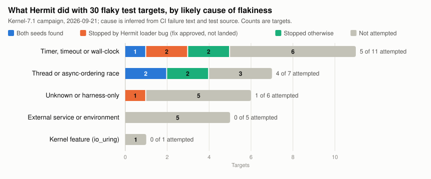

# Can Hermit make real flaky tests pass and fail on demand? A small experiment on 30 Meta flaky tests

*Mini paper, dev-hermit TFA write-up, revised 2026-09-29. Machine-readable provenance, including every
full commit SHA and binary hash: [metadata.json](metadata.json). Appendices are listed at the end.*

## Abstract

A flaky test passes on some runs and fails on others. We asked whether Hermit, a deterministic Linux
sandbox, can turn a real flaky test from Meta's CI into two repeatable commands: a seed on which the test
passes and a seed on which it fails. We fixed 30 flaky Buck test targets, 3 from each of 10 service
families, and bucketed them by likely cause of flakiness. On one host we attempted 10 of them, using 294
seed trials and 76 minutes of Hermit time.

Hermit found both seeds for **3 of the 10**: 2 of the 4 attempted thread races and 1 of the 5 attempted
timing flakes. Each failing seed prints the assertion that CI records for that test. A Hermit loader bug
stopped 3 more targets before their tests ran; its fix has since landed, but they are not yet retested. The other 4
attempted targets were stopped by harder Hermit defects, by ptrace speed, or by never failing. Eight days
later, current Hermit main re-found a passing and a failing seed for all 3 successes, in 18 of 18
deterministic trials.

## 1. Introduction

A flaky test's failure depends on timing that is lost once the run ends, so CI cannot replay it. Hermit
runs a program under its own scheduler and virtual clock. A **seed** fixes Hermit's scheduling choices,
so the same seed gives the same run. A failing seed and a passing seed turn a flake into two commands a
developer can rerun.

This idea is not new at Meta. The Test Flakiness Analyzer (TFA) reran flaky tests under Hermit on
Sandcastle in 2021–2022. It is now switched off: its rate limit is 0 runs per day, and its trigger was
deleted on 2025-10-01 ([WAY_FORWARD.md](WAY_FORWARD.md)). We re-asked its core question by hand, with
current Hermit.

**Success rule.** The owner's rule: a target succeeds if Hermit produced a passing seed and a failing
seed; no root cause or fix is required. The campaign applied a stricter rule, fixed in advance: both
seeds from one configuration, each confirmed by two agreeing runs, and the failure declared in advance.
Both rules give the same 3 successes; under the owner's rule AsyncSSL would have qualified at its 41st
trial instead of its 160th ([TARGETS.md](TARGETS.md#how-to-read-this-table)). The owner asked how many tests we
tried, and, by cause of flakiness, how many Hermit handled or could handle after an easy bugfix.

## 2. Method

**Population.** On 2026-09-17 we ranked tests by TestInfra's Probabilistic Flakiness Score (PFS, at least
5%) within each service, removed duplicate Buck targets and preferred Linux-native tests. That fixed a
registry of 30 targets, 3 from each of cachelib, folly, logdevice, manifold, mcrouter, mysql, proxygen,
thrift, warm_storage and zippydb ([TARGETS.md](TARGETS.md)); PFS 17.22%–49.47%, prior-week CI failure
rates 0/29 to 72/75.

**Cause buckets.** On 2026-09-28, after the campaign, we put each target in one likely-cause bucket, using
the test's recent CI failure text and its source. The buckets are thread or async-ordering race; timer,
timeout or wall-clock; external service or environment; kernel feature; and unknown. The buckets are
inference, not proven root causes; the evidence for each target is in [TARGETS.md](TARGETS.md).

**Environment.**

| Item | Campaign (2026-09-21) | Replication on main (2026-09-29) |
|---|---|---|
| Host | devbig030: AMD EPYC 9D85, Linux 7.1.3 | same host |
| Hermit | `4630ee2a`: main plus one patch that later landed as https://github.com/rrnewton/hermit/pull/3142 | main `4101426a`, release build |
| Mode | ptrace backend, strict mode, seeded random ("chaos") scheduling, hardware branch-counter timer | same |
| Limit per trial | 120 s wall, 16 GiB memory | 300 s wall, 16 GiB memory |
| Test binaries | Buck outputs at fbsource `7f239d5b`, run directly with a GoogleTest filter | the same three files, checked against the recorded sha256 |

**Trials.** A **trial** is one seed tried once. Hermit's **strict verify** mode runs the test twice with
that seed, and the two runs' logs of scheduling and system-call results must match exactly. A trial ends
in one of three ways:

- **PASS:** the selected test passed.
- **FAIL:** the test printed the failure declared in advance, taken from the line that fails in CI.
- **Discarded:** anything else, such as a Hermit error, a timeout, differing runs, or a real failure
  other than the declared one.

Every run went through `bin/safehermit`, a wrapper that bounds time, memory and output
([EXPERIMENTS.md](EXPERIMENTS.md) section 3).

**Configurations.** A **configuration** fixes every Hermit setting except the one seed being swept. We
varied the scheduler seed, a fuzzing seed that perturbs signals and wake-ups, per-thread slowdown (each
thread runs at a seeded fixed speed, up to F times slower or faster), the guest clock rate, the timeslice
and the guest start date. A pilot on kernel 6.13 (2026-09-20) tried 10 targets with one seed each. The
campaign then ran one base configuration per target, sized from its CI failure rate, and 15 follow-ups for
4 of the 5 targets that reached their test. Each configuration was committed to git before it ran; the
follow-ups were chosen after seeing earlier results. A configuration stopped when one seed passed and
another failed, each confirmed by strict verify's two runs, or when its seed list ran out. All 25
configurations are listed in [EXPERIMENTS.md](EXPERIMENTS.md).

**Replication.** On 2026-09-29 we re-ran each success's winning configuration on current Hermit main, with
6 seeds per test: the two campaign seeds first, then four more. Only the Hermit binary, the seed, the log
directory and the time limit changed. Every failure was checked by hand against its declared signature
([ROUND2.md](ROUND2.md) section 3).

## 3. Results

### 3.1 How many tests we tried

| Stage | Targets |
|---|---:|
| Registry | 30 |
| At least one Hermit trial, pilot or campaign | 13 |
| Attempted in the kernel-7.1 campaign | 10 |
| Reached the selected test under Hermit | 5 |
| At least one valid PASS or FAIL trial | 4 |
| **Passing seed and failing seed (success)** | **3** |

- **Campaign:** 294 trials (198 PASS, 3 FAIL, 93 discarded), 4,562 s of Hermit time (median 5 s per trial,
  range 3–121 s), over 8 h 22 min of calendar time. We estimate that one Hermit run took about 1.5 to 13
  times as long as a native run ([HERMIT_DEFECTS.md](HERMIT_DEFECTS.md) section 3).
- **Pilot:** 9 trials, none valid. 5 of its 10 targets aborted on a Hermit RLIMIT_CORE bug, since fixed.
- **Not attempted (20):** most were too slow natively, needed a service, had too many threads for ptrace,
  or could not run on this host ([TARGETS.md](TARGETS.md)).

### 3.2 By cause of flakiness: what Hermit handled

*Figure 1. "Stopped otherwise" merges the table's last two "stopped" columns: 3 targets stopped by another
Hermit defect or limit, and 1 that ran but never failed. Data: [figures/cause_buckets.csv](figures/cause_buckets.csv),
generated from [targets.csv](targets.csv) by [figures/make_cause_buckets.py](figures/make_cause_buckets.py).*

| Likely cause | Targets | Attempted | Both seeds | Stopped by loader bug (since fixed) | Stopped by other Hermit defect or limit | Ran, no failing seed | Not attempted |
|---|---:|---:|---:|---:|---:|---:|---:|
| Timer, timeout or wall-clock | 11 | 5 | 1 | 2 | 1 | 1 | 6 |
| Thread or async-ordering race | 7 | 4 | 2 | 0 | 2 | 0 | 3 |
| Unknown or harness-only | 6 | 1 | 0 | 1 | 0 | 0 | 5 |
| External service or environment | 5 | 0 | 0 | 0 | 0 | 0 | 5 |
| Kernel feature (io_uring) | 1 | 0 | 0 | 0 | 0 | 0 | 1 |
| **Total** | **30** | **10** | **3** | **3** | **3** | **1** | **20** |

The seven attempted targets without a success:

| Target | Bucket | What stopped it | Easy fix? |
|---|---|---|---|
| LogStore retry (logdevice) | timing | Hermit loader bug: a successful `openat` of a shared library became EFAULT | fixed on hermit main `3b5f7cdc` (https://github.com/rrnewton/hermit/pull/3374), not yet retested; may then hit the time limit before its test (inference) |
| McRefill (mcrouter) | timing | same loader bug | same fix; no test output natively by 25 s, 6 server processes, so likely too slow |
| Transport monitor (proxygen) | unknown | same loader bug | same fix; should then reach its test (untested), but it has no competing threads, so a failure is unlikely |
| Health monitor (logdevice) | race | Hermit's own timer signal killed 96 of 98 threads (strong inference) | no: https://github.com/rrnewton/reverie/issues/747, and 657 native threads make ptrace impractical |
| TLS terminator (proxygen) | race | 31 trials, no pass, all discarded because of Hermit: differing runs, and a certificate error in all 15 trials under Hermit's old fixed start date | no: open determinism gaps, unreachable services |
| EventTracker (cachelib) | timing | the 120 s limit: Hermit's ptrace path traps every clock read | a longer limit might let it finish; outcome unknown |
| TimerFD (folly) | timing | 9 of 9 trials passed: only fuzzing seeds were tried, and Hermit's timerfd uses a real host timer | medium effort: https://github.com/rrnewton/hermit/pull/3229 plus time settings |

**Answer to the owner's question.** Hermit produced both seeds for 3 of the 10 attempted targets (3 of
30 in the registry): 2 of 4 races and 1 of 5 timing flakes. One real Hermit bug stopped 3 more, and its
fix has landed. But no fourth success is proven to be one easy fix away: of those three,
one probably cannot fail and two will probably need a longer time limit (inference). An earlier easy fix
did matter. The pilot's RLIMIT_CORE fix was necessary, though not sufficient, for two of the three
successes.

### 3.3 The three successes, on the campaign binary and on current main

| Test (bucket) | Winning configuration | Campaign seeds (pass / fail) | Main `4101426a`, 6 seeds (pass / fail / other) | Failure printed, and in CI |
|---|---|---|---|---|
| folly `async_ssl_socket_test` (race) | slowdown up to 8x, 5 ms timeslice | 1 / 11 | 1, 3, 4 / **11** / 0, 2 (a different failure, line 3592) | `AsyncSSLSocketTest.cpp:3797` and `:3812`; CI shows `:3797` in 3 of 3 recent failures |
| thrift `InstrumentationTest` (race) | slowdown up to 10x, 1 ms timeslice | 0 / 1 | 0, 1, 2, 5 / **3, 4** / none | `InstrumentationTest.cpp:836`, snapshot count 2 instead of 3; the same in CI |
| proxygen `HTTPCoroSessionTests` (timing) | clock rate 0.5, slowdown up to 10x | 3 / 0 | 1, 3, 4, 5 / **0, 2** / none | `HTTPDownstreamCoroSessionTests.cpp:1685` CHECK, then abort; CI shows it in 2 of 3 |

CI status today is in [TARGETS.md](TARGETS.md#ci-status-of-the-three-successes-on-2026-09-28).

- **Replication:** all 18 replication trials were deterministic, and the whole replication took 4 min
  25 s. Thrift's old failing seed now passes, so seeds must be re-found whenever Hermit changes.
- **Cost of each success** under the campaign's rule: AsyncSSL needed 10 configurations and 160 trials;
  Thrift needed 3 (plus 1 rejected run) and 61; HTTPCoro needed 3 and 28 ([EXPERIMENTS.md](EXPERIMENTS.md)
  section 3.2).
- **A common pattern:** varying only thread order or signals gave a single outcome (AsyncSSL 36 passes,
  Thrift 58 passes, HTTPCoro 16 aborts). Per-thread slowdown alone gave 44 passes and no failures, and
  slowdown with clock rate 0.125 gave 8 more passes. Both outcomes appeared only in configurations that
  combined slowdown with a timeslice or clock-rate change, and not in all of them. Hypothesis: reordering
  threads at system calls does not move timing far enough.

### 3.4 Where the discarded trials went

| Cause | Trials, of 93 discarded |
|---|---:|
| The two runs of a seed differed | 44 |
| AsyncSSL failed at a different line (3592) | 24 |
| HTTPCoro failed at the right line, but the declared pattern was mis-written | 16 |
| TLS certificate error under Hermit's old fixed start date | 2 |
| A Hermit error (loader bug 3, timer signal 1, timer-overshoot refusal 1) | 5 |
| The 120 s limit | 2 |

Hermit itself stopped 49 of the 93: the 44 differing runs plus the 5 Hermit errors. Counting the old
start date and the two time-limit hits, it was 53 ([HERMIT_DEFECTS.md](HERMIT_DEFECTS.md) section 2).

39 of the 44 differing runs trace to three open defects: teardown order after an abort
(https://github.com/rrnewton/hermit/issues/3247), loopback socket readiness
(https://github.com/rrnewton/hermit/issues/3330), and an intermittent clock drift under per-thread
slowdown (https://github.com/rrnewton/hermit/issues/3329). The other 5 are unexplained. The Hermit errors
are https://github.com/rrnewton/hermit/issues/3328 (loader bug), https://github.com/rrnewton/reverie/issues/747
(timer signal) and https://github.com/rrnewton/hermit/issues/1845 (overshoot refusal).

## 4. Threats to validity

1. **Selection.** The 10 attempted were chosen for short runtimes and few threads, so 3 of 10 is not a
   general success rate.
2. **Adaptive search.** Follow-ups were chosen after seeing results; each was committed before it ran, and
   each failure had to match CI's own message.
3. **One host, ptrace only.**
4. **Existence, not rates.** No pass or fail probability is estimated; a seed's second run checks
   repeatability, not an independent sample.
5. **Inferred causes.** Buckets were assigned after the campaign, with its results known; buckets and
   easy-fix judgements are untested inference.
6. **Record-keeping** caveats that leave the success count unchanged: [EXPERIMENTS.md](EXPERIMENTS.md)
   section 8.

## 5. Conclusion and next steps

Hermit can find a passing and a failing seed for real Meta flaky tests. It did so for 3 of the 10
targets we attempted, and current Hermit main still does. The main obstacles were in Hermit itself:
about half the discarded trials, one loader bug that stopped three targets, and a ptrace backend that is
slow and weak with many threads.

A later **phase-two prototype**, 22 unpublished fbsource diffs (36,416 changed lines) that replay the
seeds, ask an AI agent for a fix and draft a diff, covers only these 3 tests; we recommend not landing it
([STACK_STATE.md](STACK_STATE.md), [WAY_FORWARD.md](WAY_FORWARD.md)). Its evidence is preserved in
[evidence/phase2/](evidence/phase2/MANIFEST.md).

**Next steps** (the estimates are ours):

1. **Retest the three loader-blocked targets** on fixed Hermit (hermit main `3b5f7cdc`, where
   https://github.com/rrnewton/hermit/pull/3374 landed on 2026-09-30). This needs their Buck test binaries rebuilt
   on an OnDemand node, then up to 12 seeds each. About half a day to a day. The plan is in
   [RETEST_PLAN.md](RETEST_PLAN.md); it has not started, pending the owner.
2. **Re-find seeds on every Hermit change,** with a small script-driven loop in dev-hermit (where it lives
   is decided).
3. **Fix the three open determinism defects** in section 3.4. Together they explain 39 of the 44
   differing-run trials.

Four decisions remain the owner's ([WAY_FORWARD.md](WAY_FORWARD.md)):

- whether to abandon or keep the 22 drafts;
- whether to send the prototype's test-only AsyncSSL patch to that test's owners;
- which channel to post results to;
- whether to review D121815443, a bot-written fix for Hermit's own failing Sandcastle test.

## Sources and appendices

Every number above comes from the files below; paths are relative to this directory unless noted.

| File | What it holds |
|---|---|
| [metadata.json](metadata.json) | full SHAs, binary and input hashes, run windows, commands, redaction policy |
| [TARGETS.md](TARGETS.md), [targets.csv](targets.csv) | all 30 targets: cause bucket with evidence, outcome, seeds, why not both seeds, easy-fix judgement |
| [figures/](figures/) | Figure 1, its data and the script that makes it |
| [EXPERIMENTS.md](EXPERIMENTS.md) | every experiment and all 25 configurations, with counts and times |
| [HERMIT_DEFECTS.md](HERMIT_DEFECTS.md) | Hermit defects with evidence and GitHub records; discarded-trial and cost detail |
| [ROUND2.md](ROUND2.md), [round2/](round2/) | the 2026-09-29 round: evidence copy, loader fix and its reviews, replication runs |
| [RETEST_PLAN.md](RETEST_PLAN.md) | the plan (not started) for retesting the three loader-blocked targets |
| [STACK_STATE.md](STACK_STATE.md), [WAY_FORWARD.md](WAY_FORWARD.md) | the 22-diff prototype and the way forward |
| [evidence/](evidence/MANIFEST.md) | copies of non-repository sources, with redaction records |
| [SOURCES.md](SOURCES.md) | the source keys the appendices cite (for example `[CAMP §5]`) and the first draft's provenance |
| `experiments/tfa-kernel71-campaign_20260921/RESULTS.md` (repository root) | the campaign's own long-form report |
| `experiments/tfa-kernel71-*_20260921/services/*/*/experiment.json` | the 25 campaign records |
