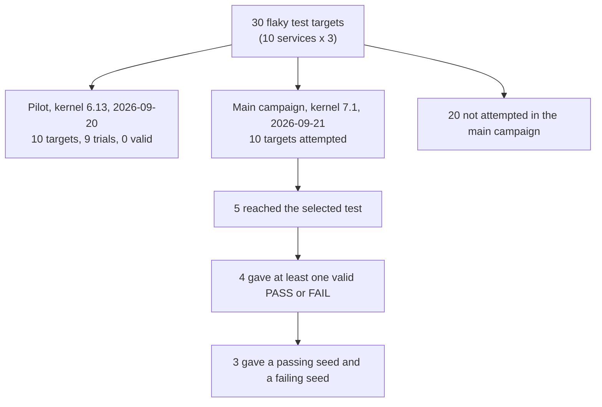

# Can Hermit make real flaky tests pass and fail on demand? A small experiment on 30 Meta flaky tests

**At a glance** (a *seed* is a number that fixes Hermit's thread schedule)

- **Population:** 30 flaky Meta test targets (10 services x 3); 10 attempted in the main campaign, and 13 had at least one Hermit trial counting the pilot (section 3.1).
- **Result:** 3 of the 10 got a repeatable passing seed and failing seed, failing with CI's message: AsyncSSL (pass 1, fail 11), Thrift InstrumentationTest (0, 1), HTTPCoro (3, 0) (section 3.2).
- **Cost:** 294 seed trials on 2026-09-21 (198 pass, 3 fail, 93 discarded); 76 min of Hermit time within 8 h 22 min, on one host (section 3.3).
- **Obstacles:** specific Hermit defects stopped 4 of the other 7 attempted targets (one by strong inference), 3 through one loader bug that is unfixed (filed 2026-09-28 as https://github.com/rrnewton/hermit/issues/3328). A fifth, the TLS terminator, never passed; all 31 of its trials were discarded because of Hermit. Hermit stopped 49 of the 93 discarded trials (sections 3.3, 4 and 5).
- **Prototype:** a 22-diff unpublished Phabricator stack (36,416 changed lines) automates only these 3 tests; we recommend not landing it and building a small loop in dev-hermit (section 9).

**Provenance.** Written 2026-09-28 by sub-tfa2-030, a read-only Claude subagent, for the owner; no test
or Hermit run was repeated. Repository records were read at dev-hermit `1393fcda8e20c4b06f0aec5b32f071a6e9a8fd40`
(`main`, 2026-09-28T08:59:22-07:00); the TFA records are identical at the newer local `origin/main`
`864ab69db945`. Other sources (the old TFA lane, untracked phase-two evidence, non-durable `/tmp`
notes, read-only Phabricator, TestInfra and GitHub queries of 2026-09-28) are listed in
[EXPERIMENTS.md section 9](EXPERIMENTS.md#9-provenance-of-this-write-up). [evidence/MANIFEST.md](evidence/MANIFEST.md)
maps each copied file to its original, with hashes. Bracketed keys such as [RES §4.1] point to
[Sources](#sources); "(inference)" marks a statement the records do not prove.

## Abstract

We asked whether Hermit, a deterministic Linux sandbox, can find two repeatable seeds for a real
flaky test from Meta's CI: one on which it passes and one on which it fails. From TestInfra's
flakiness data we fixed 30 targets, 3 from each of 10 service families. A pilot on kernel 6.13
(2026-09-20) tried 10 with one seed each (9 trials ran) and had no success; 5 stopped on one
Hermit bug, since fixed. The main campaign (kernel 7.1, one host, 2026-09-21) attempted 10 targets in 25
configurations and 294 seed trials, using 76 min of Hermit time. It found both seeds for **3 of the
10** (folly AsyncSSLSocket, Thrift InstrumentationTest, Proxygen HTTPCoro), each failing with the
assertion message CI records, and only in configurations that varied each thread's speed and also
changed the timeslice or clock rate. Of the other 7, 4 were stopped by specific Hermit defects (3 by
one loader bug that is unfixed, now filed as https://github.com/rrnewton/hermit/issues/3328), and all 31 trials of a fifth were
discarded because of Hermit. We found no evidence that an easy fix would give a fourth success.

## 1. Question

A **flaky test** passes on some runs and fails on others with no code change. CI records the
failure but usually cannot reproduce it: the thread timing that caused it is gone. Hermit runs a
program under its own scheduler and virtual clock, and a **seed** fixes its scheduling choices, so
the same seed gives the same run. A failing seed and a passing seed turn a flake into two commands
a developer can rerun.

TFA, the Test Flakiness Analyzer, reran flaky tests under Hermit on Sandcastle, Meta's CI job
system, in 2021-2022 [WF §1 row 2]. It is off: its rate limit is 0 runs per day, and its trigger was
deleted on 2025-10-01 [WF §0 item 6]. We re-asked it by hand with current Hermit.

**Success rule (the owner's):** Hermit produced a passing seed and a failing seed; no root cause or
fix is required.

## 2. Setup

### 2.1 Population

On 2026-09-17 we ranked tests within each service by TestInfra's Probabilistic Flakiness Score,
kept scores of at least 5%, removed duplicate Buck targets and preferred Linux-native tests [SRC].
That fixed a registry of 30 targets ([TARGETS.md](TARGETS.md)): 3 from each of cachelib, folly,
logdevice, manifold, mcrouter, mysql, proxygen, thrift, warm_storage and zippydb, each with one
test case and one build mode. Scores range from 17.22% to 49.47% and prior-week CI failure rates
from 0/29 to 72/75 [COH]; they only chose and ordered candidates.

### 2.2 Environment

| Item | Value | Source |
|---|---|---|
| Host | devbig030, AMD EPYC 9D85, x86_64 | [K71] `cells[0].host`, 25/25 |
| Kernel | Linux 7.1.3-0_fbk0_0_g295ad0959f34 (pilot: 6.13.2) | [K71], [K613] |
| Hermit | Revision `4630ee2a`: main `4dcb34b4` plus one patch that later landed as `ccbe37e91` (https://github.com/rrnewton/hermit/pull/3142); the exact binary was never a main commit. Pilot: `79da5231`, 50 commits earlier. Binary hash: [EXPERIMENTS.md](EXPERIMENTS.md) section 3 | [RES §3.2]; [CONT §6]; `git -C hermit rev-list --count 79da5231..4630ee2a` |
| Mode | ptrace backend (Hermit stops the program at every system call through Linux's debugging interface); strict mode; seeded random ("chaos") scheduling; hardware branch-counter timer, no fallback | [RES §3.2] |
| Limits per trial | 120 s wall, 16 GiB memory, no swap, 64 MiB log caps | [RES §3.2] |
| Test binaries | Built by Buck outside Hermit at fbsource `7f239d5b`, run directly with a GoogleTest filter. All 540 recorded run commands start with `bin/safehermit`, a bounding wrapper, and none contains `buck` | [RES §3.1] |

### 2.3 What one trial is

A **trial** is one seed, tried once. Hermit's **strict verify** mode runs the test twice with that
seed and requires the two runs' detailed logs of scheduling and system-call results to match
exactly. A trial ends as **PASS** (the selected test ran once and passed), **FAIL** (it printed the
failure declared in advance, from the source line that fails in CI) or **discarded** (the records
say "censored"): anything else, such as a Hermit error, a timeout, differing runs or a real failure
other than the declared one. Command shape [RES §3.1]:

```text
bin/safehermit --sh-deadline 120 ... HERMIT run --backend ptrace --strict --chaos ... \
  --seed 0 --rng-seed 0 --sched-seed S --fuzz-seed F --sched-heuristic random \
  --verify --verify-strict --verify-allow both --keep-logs ... -- TEST_BINARY --gtest_filter=CASE
```

### 2.4 Configurations

A **configuration** (the records say "cell") fixes everything except the seed; all 25 are in
[EXPERIMENTS.md](EXPERIMENTS.md) section 3.2. Settings varied [CONT §2; Hermit
`detcore-model/src/config.rs` at `4630ee2a`]:

- `--sched-seed`: seeded random choice of which thread runs next.
- `--fuzz-seed` with `--chaos-target-races`: seeded random signals and wake-ups.
- `--chaos-per-thread-slowdown --chaos-slowdown-max-factor=F`: each thread runs at one fixed speed
  between 1/F and F times normal, chosen by the seed, as seen by the scheduler and its own clock.
- `--clock-multiplier` (guest clock rate); `--target-timeslice` (virtual time a thread may run
  before a switch at a system call); `--epoch` (guest start date, 2026-01-01 if omitted).

### 2.5 Design

- **Pilot** (2026-09-20): 10 targets on kernel 6.13, one seed each; 9 trials, as one run (Manifold
  Rust client) was rejected before the guest started [EXP §2].
- **Round 1** (2026-09-21): one fuzz-seed configuration per target, sized by its CI failure rate.
  Thrift (CI rate 0/29) got seeds 0-35, for a minimum detectable failure probability of 0.10 chosen
  in advance, but its only run was rejected [RES §3.3; K71 `plan.measurement_design.design_basis`;
  EXP §3.2 row 10].
- **Round 2**: 15 follow-up configurations for 4 of the 5 targets that reached their test, adding
  real dates, scheduler seeds, slowdown, clock and timeslice settings. Each was committed to git
  (seeds, declared failure, stop rule) before it ran, but was chosen after seeing earlier results.
- **Stop rule**: stop once one seed passes twice and another fails twice; otherwise run all seeds.

The campaign's rule, fixed before any run [ACC], is the owner's made strict: both seeds in one
configuration, both runs of each seed agreeing, and the declared failure. The owner's wording gives
the same 3 successes [TGT] with less effort: AsyncSSL would have qualified by its 3rd configuration
instead of its 10th, and HTTPCoro by its 2nd [K71] (details:
[TARGETS.md](TARGETS.md#how-to-read-this-table)).

## 3. Results

### 3.1 How many tests we ran



| Stage | Targets | Source |
|---|---:|---|
| Registry | 30 | [COH] |
| Hermit launched, either campaign | 14 (10 main plus 4 pilot-only); 13 with at least one trial | [K613], [K71] |
| Attempted in the main campaign | 10 | [RES §4.1] |
| Reached the selected test under Hermit | 5 | `selected=` in each record's `events[].result.diagnostic` [K71] |
| At least one valid PASS or FAIL trial | 4 | [RES §4.1] |
| **Passing seed and failing seed (success)** | **3** | [RES §4.2] |

The main campaign ran 294 trials: 198 PASS, 3 FAIL and 93 discarded [CONT §0]; the pilot ran 9
trials with 0 valid [EXP §6]. Most of the other 20 were too slow natively, needed a service, had
too many threads for ptrace or could not run on this host [FIX §2; SCR] (all reasons:
[TARGETS.md](TARGETS.md#why-20-targets-were-not-attempted)).

### 3.2 The three successes

| Target | Winning configuration | Pass seed | Fail seed | Failure under Hermit, and in CI | Configurations / trials | Hermit time per trial |
|---|---|---:|---:|---|---|---|
| folly `async_ssl_socket_test`, `ObserverAttachedBeforeConnect` | slowdown up to 8x, 5 ms timeslice | 1 | 11 | `AsyncSSLSocketTest.cpp:3797`: 3 byte events, expected at least 4; `:3812`: expected ACK offset 501, got zero. CI: `:3797` in 3 of 3 recent failures [TI 562950211052906] | 10 / 160 | median 4 s; both winning trials 3 s |
| thrift `InstrumentationTest`, `snapshotStartedProcessingTest` | slowdown up to 10x, 1 ms timeslice | 0 | 1 | `InstrumentationTest.cpp:836`: `reqSnapshots.size()` is 2, expected 3. CI: the same, 1 recent failure [TI 281475235299286] | 3 (plus 1 rejected run) / 61 | median 15 s |
| proxygen `HTTPCoroSessionTests`, `ResetRateLimit/h2` | clock multiplier 0.5, slowdown up to 10x | 3 | 0 | `HTTPDownstreamCoroSessionTests.cpp:1685] Check failed: bodyEvent.hasException()`, then abort. CI: `:1685` in 2 of 3 recent failures [TI 562950215319283] | 3 / 28 | pass 7 s; fail 110 s |

Sources: [RES §3.2, §4.2]; [CONT §2-3]. All three used scheduler seeds. CI status today:
[TARGETS.md](TARGETS.md#ci-status-of-the-three-successes-on-2026-09-28).

**What it took.** AsyncSSL's declared failure appeared once in 160 trials, at seed 11 of its 10th
configuration; the earlier nine (148 trials) gave passes and a different failure at line 3592.
Thrift gave 58 passes and 1 Hermit refusal without slowdown, then succeeded in 2 trials with
slowdown and a 1 ms timeslice. HTTPCoro aborted at the right line on all 16 seeds of its first
configuration, but a mis-written failure pattern discarded them; clock 0.125 passed 8 of 8, and
clock 0.5 gave both seeds within 4 [CONT §2, §4]. Its failing phase is single-threaded (1,001 resets
must fit a 100 ms rate-limiter window): a time-budget flake, not a thread race [RES §4.3].

**The common pattern.** Varying only thread order or signals gave one outcome (AsyncSSL 36 passes,
all in fuzz-seed sweeps; Thrift 58 passes; HTTPCoro 16 aborts). Both outcomes appeared only with
per-thread slowdown [CONT §1], but four slowdown configurations without a timeslice change gave 52
valid PASS and 0 FAIL. Each winner also changed the timeslice (AsyncSSL 5 ms, Thrift 1 ms) or the
clock (HTTPCoro 0.5), and every AsyncSSL configuration that failed at all set a timeslice [K71
`cells[0].hermit.argv`, `samples[]`]. Inference: slowdown plus a timeslice or clock change moves
timing far enough, where reordering threads does not; the records cannot separate the two settings.

### 3.3 Cost and discarded trials

The 294 trials took 4,562 s of Hermit time (about 76 min; median 5 s, range 3-121 s) within 8 h 22
min; the rest went to planning, committing configurations and review [CONT §3]. A Hermit run was
about 1.5 to 13 times slower than native, depending on the test and baseline, and HTTPCoro's failing
seed took 110 s of the 120 s limit (inference from [CONT §3]). Of the 93 discarded trials, 44 had
differing runs, 42 were real failures other than the declared one, and 7 were Hermit errors or 120 s
timeouts. Hermit itself stopped 49, and 4 more trace to its old default date (strong inference) or
slow ptrace path [CAMP §5; CONT §1]. Detail: [HERMIT_DEFECTS.md](HERMIT_DEFECTS.md) sections 2-3.

## 4. Flakiness causes and what Hermit did

Buckets are inferred from CI failure text (TestInfra, week before 2026-09-28 [TI]) and test source,
not proven. "Easy" means an existing setting or a small change whose mechanism logs and source
prove; none was tried.

| Likely cause | Targets | Attempted | Success | Stopped by a Hermit defect | Stopped otherwise | Not attempted | Past its current stop with an easy fix (untested) | Both seeds after that (judgement) |
|---|---:|---:|---:|---:|---:|---:|---:|---|
| Thread-interleaving or async-ordering race | 7 | 4 | 2 | 1 | 1 | 3 | 0 | – |
| Timer, timeout or wall-clock | 11 | 5 | 1 | 2 | 2 | 6 | 3 | EventTracker unknown; LogStore unknown; McRefill hard |
| External service or environment | 5 | 0 | 0 | 0 | 0 | 5 | – | – |
| Kernel feature (io_uring) | 1 | 0 | 0 | 0 | 0 | 1 | – | – |
| Unknown or harness-only | 6 | 1 | 0 | 1 | 0 | 5 | 1 | unlikely |
| **Total** | **30** | **10** | **3** | **4** | **3** | **20** | **4** | **0 proven** |

Source: [TGT], from [FIX §3]. The TLS terminator is "stopped otherwise" because no single Hermit
defect stopped it. EventTracker and LogStore are placed under timing on weak evidence [TGT placement
notes]. The 10 attempted targets (detail: [TARGETS.md](TARGETS.md)):

| Target | Likely cause | What happened | Easy fix or setting (untested) | Both seeds then? |
|---|---|---|---|---|
| AsyncSSL (folly) | race | Success | – | – |
| InstrumentationTest (thrift) | race | Success | – | – |
| HTTPCoro (proxygen) | timing | Success | – | – |
| TimerFD (folly) | timing | 9 of 9 passed; only fuzz seeds, on one event-loop thread; Hermit's timerfd uses a real host timer | Not easy: time settings plus probably a virtual timerfd (open PR https://github.com/rrnewton/hermit/pull/3229) | Unknown, medium effort |
| EventTracker (cachelib) | timing (weak) | 120 s timeout: Hermit's ptrace path was slow, the test not hung [LOGS] | Raise the time limit; how far is unknown [FIX §1.5] | Unknown |
| LogStore retry (logdevice) | timing (weak) | Loader error (defect 1) | Small fix, or `--no-virtualize-metadata`; may then time out before its test (inference) | Unknown |
| McRefill (mcrouter) | timing | Loader error (defect 1) | Same | Hard: over 25 s natively, 6 server processes |
| Transport monitor (proxygen) | unknown | Loader error (defect 1) | Same | Unlikely: no competing threads |
| Health monitor (logdevice) | race | A stray Hermit timer signal killed 96 of 98 threads, then "deadlock" (defect 2; strong inference) | No: medium bug fix | Hard: 657 threads natively |
| TLS terminator (proxygen) | race | 31 trials, no pass, all discarded because of Hermit (29 differing runs; 2 aborts under its old fixed date, strong inference). With a real date all 16 aborted with `folly::FutureTimeout`, a failure declared in advance. Why none passed is not established | Date fixed on main; the rest is not easy | Hard |

Sources: [FIX §0-1]; [TGT] rows 3-5, 7, 9, 13, 19-21, 24.

**Answer to the owner's question.** Hermit produced a passing and a failing seed for 3 of the 10
attempted targets (3 of 30 in the registry): 2 of the 4 attempted races and 1 of the 5 attempted
timing flakes. No further target is proven to be one easy fix away. A loader fix would get 3 more
targets past the loader, but only the transport monitor (a 27-36 ms test, 4-8 s wall natively)
plausibly reaches its test then: LogStore and McRefill, with no test output natively by 13 s and
25 s, would probably hit the 120 s limit, shared by both runs of a trial, before their test, as
EventTracker (also over 13 s natively) did (inference) [SCR]. Of those 4, the evidence rates 2
unknown, 1 unlikely and 1 hard. That is not an upper bound (inference): TimerFD could next try
scheduler seeds with existing time settings, as single-threaded HTTPCoro did, and TLS and the 20
unattempted targets were not assessed.

## 5. Hermit defects and gaps

Status as of hermit `origin/main` `fdd8f55a8e7c` (2026-09-28) [FIX], rechecked at `ad21724d5f64` (2026-09-28 16:44 -0700; no status changed); evidence and GitHub records
are in [HERMIT_DEFECTS.md](HERMIT_DEFECTS.md#1-defects-and-gaps).

| # | Defect or gap | Effect in this experiment | Status |
|---:|---|---|---|
| 1 | After a successful `openat`, Hermit's extra metadata fetch (`inject_fstat`) turns the result into a bad-address error (EFAULT) | Stopped 3 targets in the loader | **Not fixed**; filed as https://github.com/rrnewton/hermit/issues/3328 |
| 2 | Hermit's own timer signal reaches the program (strong inference) | Killed 96 of 98 health-monitor threads | Not fixed; same symptom as open https://github.com/rrnewton/reverie/issues/747 (evidence added) |
| 3 | Thread-teardown events after an abort are logged in host order | 14 of the 44 run-to-run differences | Open; same mechanism as https://github.com/rrnewton/hermit/issues/3247 (abort variant added as a comment) |
| 4 | Readiness of in-process loopback sockets follows host timing | 15 of the 44 | Open; filed as https://github.com/rrnewton/hermit/issues/3330 |
| 5 | The virtual clock differs by a few nanoseconds between runs under per-thread slowdown | 10 of the 44 | Open; filed as https://github.com/rrnewton/hermit/issues/3329 |
| 6 | Fixed default guest date of 2026-01-01 | TLS "certificate not yet valid" in 15 of 15 trials without a real date | **Fixed** by `402ba9737` (https://github.com/rrnewton/hermit/pull/3151) |
| 7 | Hermit refused to set the core-dump size limit (RLIMIT_CORE), aborting sanitizer builds | Stopped 5 of 10 pilot targets | **Fixed** by `ccbe37e91` (https://github.com/rrnewton/hermit/pull/3142) |
| 8 | Hardware-counter timer overshoot refusal | 1 Thrift trial; the pilot TLS trial | Open: https://github.com/rrnewton/hermit/issues/1845 |
| 9 | timerfd is armed with a real host timer | Probably why TimerFD never failed (inference) | Open PR https://github.com/rrnewton/hermit/pull/3229 |
| 10 | ptrace is slow: clock reads are trapped, and many threads are slow | EventTracker timeout; 3 targets excluded for thread count | Structural; no issue found |

Defect 1 is the cheapest to act on: it blocks 3 targets, logs and source prove that `inject_fstat`
turns successful opens into EFAULT (where inside it the fault occurs is a hypothesis), and the
192/512-byte probe is a ready-made regression test [PROBE; FIX §1.1].

Project policy (dev-hermit `AGENTS.md`) requires a GitHub issue for every real product defect, so
sub-tfa2-030 filed or extended one for each unfiled defect on 2026-09-28 (bodies read back and
byte-identical to what was sent):

- Defect 1: https://github.com/rrnewton/hermit/issues/3328 (new).
- Defect 2: https://github.com/rrnewton/reverie/issues/747#issuecomment-5881331809 (evidence added to the open issue about the same symptom).
- Defect 3: https://github.com/rrnewton/hermit/issues/3247#issuecomment-5881331489 (abort-time variant added).
- Defect 4: https://github.com/rrnewton/hermit/issues/3330 (new).
- Defect 5: https://github.com/rrnewton/hermit/issues/3329 (new).

Defect 10 is structural and was not filed.

## 6. Follow-on: phase-two prototype

A prototype then tried to automate the next steps (replay the seeds, have an agent propose a fix,
draft a diff) in 22 draft diffs under `fbcode/testinfra/tfa` [P2 §1].

- **Seed replays**: open-source Hermit `4630ee2a` reproduced all 6 recorded seeds (HTTPCoro's
  passing seed is 1, not the campaign's 3; [EXPERIMENTS.md](EXPERIMENTS.md) section 5): 12 of 12 in a
  relocated re-run, 30 of 30 in 5 complete prototype batches. HTTPCoro's failing seed takes
  109-118 s of the 120 s limit; 2 of its 12 validly configured attempts timed out [P2 §3.6, §3.11].
- **Seeds depend on paths**: from another directory, Thrift's failing seed 1 passed, and new failing
  seeds (3 and 8) had to be found [E3 §4].
- **Internal Hermit**: the packaged internal build (`a919cce`) never ran a recorded seed: 18 of 18
  calls refused, 0 of 8 re-qualification probes passed [P2 §3.3, §3.8].
- **Candidate fixes**: three Claude agents proposed test-only patches. Unfixed, the tests failed
  5 of 17 (Thrift), 5 of 14 (AsyncSSL) and 3 of 9 (HTTPCoro) Hermit replays; patched, they passed
  13 of 13, 8 of 9 (the ninth failed differently, as it did unfixed) and 8 of 8 [E3 abstract, §4].
  With 1-4 replays per seed, this shows only that the targeted failure did not recur; root causes
  are unverified.

## 7. Limitations

1. **One environment.** One host, kernel and Hermit binary (never a main commit); no rerun of the
   successes on current Hermit main is recorded, and phase two used the same binary.
2. **ptrace only.** About 1.5-13 times native per run (section 3.3), and weak with many threads.
3. **Selection and adaptive search.** The 10 attempted were chosen for speed and few threads, so 3
   of 10 is not a general success rate; follow-up settings were chosen after seeing results
   (section 2.5).
4. **Existence, not rates.** No pass or fail probability is estimated; a seed's second run checks
   repeatability and is not an independent sample.
5. **Fragile seeds, inferred causes.** A seed works only in its exact configuration, file paths
   included (section 6). Cause buckets are inference; easy-fix judgements are untested.
6. **Record-keeping caveats** that do not change the success count [CAMP §7]:
   [EXPERIMENTS.md](EXPERIMENTS.md) section 8.

## 8. Conclusion

Hermit can do this for real Meta flaky tests: three of the ten targets attempted have a repeatable
passing seed and failing seed, failing with CI's message. Two are thread races and one is a
time-budget flake; all three came from configurations that varied per-thread speed together with
a timeslice or clock setting. The main obstacles were in Hermit: about half the discarded trials
(49 of 93; 53 counting its old default date and slow ptrace path) and 5 of the 7 targets without a
success trace to Hermit, and ptrace excluded or slowed many more. The cheapest next steps:

1. File and fix the loader bug (defect 1), with the 192/512-byte probe as its test.
2. Rerun the three successes on current Hermit main.
3. Then retry LogStore, McRefill and the transport monitor, and EventTracker with a longer time
   limit (LogStore and McRefill will probably need one too; inference).

## 9. The diff stack and the way forward

Detail and sources: [STACK_STATE.md](STACK_STATE.md) and [WAY_FORWARD.md](WAY_FORWARD.md).

**The stack.** 22 unpublished Phabricator drafts (D121244476 to D121978137, 2026-09-22 to 09-26)
add a command-line prototype under `fbcode/testinfra/tfa` for exactly the 3 tests of section 3.2.
55% of its 36,416 changed lines are one diff that runs Codex agents in a sandbox. It shares old
TFA's name and idea but no code. Nothing is reviewed or landed. What works: input checks, a
PASS-versus-FAIL log comparison, a verdict on candidate fixes, dry-run comments, and seed replays
with open-source Hermit (section 6). Blocked: the internal fbsource Hermit, the Codex agent step,
posting comments and drafting diffs. The top diff passes 528 of 559 CI signals [SS §0 item 3].

**Where it runs.** It is built for one devserver (passwordless sudo, Btrfs loop mounts, a systemd
unit), and its replays run only on devbig030, where their inputs are. On an agentcloud OnDemand
devvm (devvm895) its sandbox suite passed 37 of 43 on 2026-09-28; the replays were not tried there.
Sandcastle is "not yet": Hermit's own smoke test there has failed 53 trunk runs in a row, and a
bot-authored candidate fix, D121815443, awaits review.

**Committed pipeline, feasibility and repair.** Not this code. A small TFA is feasible as a
script-driven loop, not a service, but mostly as a rebuild: keep about 570 of the stack's lines,
drop roughly 10,000 of its 16,501 non-test lines (inference), and write an estimated 200-500 new
lines (inference). We recommend (a
judgement, not a finding): do not land the stack, but archive it and copy its untracked evidence
into a tracked directory (decision 9); fix the loader bug; build the loop in dev-hermit, re-finding
seeds for the 3 known tests on current Hermit main before trying the other 27 in small batches;
consider Sandcastle only after D121815443 lands and fbsource gets a current Hermit. No diff is
published, landed, abandoned or given reviewers without an explicit owner instruction.

**Already decided.** Heavy TFA experiments run on OnDemand agentcloud nodes, not devbig030 (owner
directive of 2026-09-28, relayed by coord2). The unfiled Hermit defects were filed under project policy
(section 5).

**Decisions only the owner can make:**

1. Abandon the 22 drafts, or keep them unpublished.
2. Where the loop lives: dev-hermit, `fbcode/hermetic_infra` or `fbcode/testinfra` (needs Test
   Infra's agreement).
3. Whether a six-seed replay (about 210 s) is light enough for devbig030, registered to another user.
4. Whether to send the AsyncSSL candidate patch to the test's owners.
5. Posting: GitHub issues only, or a new Hermit-owned bot.
6. Diagnosis agent: none, Claude, or Codex (blocked for now).
7. Whether to review D121815443. Landing it is the first of three Sandcastle prerequisites; the
   others are a current fbsource Hermit and a bot identity.
8. Budget: tests, seeds per test, and a wall-time cap.
9. Whether to copy the untracked phase-two evidence (`worktrees/slots/tfa-phase2-cyber-opus/ignored/`,
   partly in `/tmp/tfa-phase2`) into a tracked directory; it is time-sensitive, as it sits under
   another agent's slot.

## Sources

Repository paths are relative to `/home/newton/work/dev-hermit`. Files under
`/tmp/sub-tfa2-030/` are this write-up's evidence notes (2026-09-28) and are not durable; the
"Copy" column gives the copy kept in this directory. The copies of the gatherer notes are
verbatim, so paths inside them still name the `/tmp` originals; translate them with
[evidence/MANIFEST.md](evidence/MANIFEST.md).

| Key | Location | Copy in this directory |
|---|---|---|
| RES | `experiments/tfa-kernel71-campaign_20260921/RESULTS.md` (the campaign's own report) | tracked |
| ACC | `ai_docs/tfa-acceptance-bracket-2026-09-17.md` (success rule; commit `9d7f603c4`) | tracked |
| SRC | `ai_docs/tfa-candidate-sourcing-2026-09-17.md` (registry method; commit `ee6562142`) | tracked |
| COH | `experiments/tfa-kernel71-campaign_20260921/cohort.json` (the 30 targets) | tracked |
| SCR | `experiments/tfa-kernel71-campaign_20260921/NATIVE-CANDIDATE-SCREEN-20260921.md` | tracked |
| K71 | `experiments/tfa-kernel71-*_20260921/services/*/*/experiment.json` (25 records, 13 roots) | tracked |
| K613 | `experiments/tfa-flaky-tests_20260917/services/*/*/experiment.json` (10 pilot records) | tracked |
| PROBE | `experiments/tfa-openat-stack-size-20260917/` (openat stack-size reproducer) | tracked |
| LOGS | `ignored/safehermit-loopback/mnt/safehermit/` (retained Hermit logs; untracked) | not copied (large); the cited lines are quoted in [evidence/gather-fixability.md](evidence/gather-fixability.md) §1 and [EXPERIMENTS.md](EXPERIMENTS.md) §4 |
| TI | `/tmp/sub-tfa2-030/ti/<test id>.json` and `/tmp/sub-tfa2-030/ti-timerfd.json` (`meta testinfra.result history --test=<id> --statuses=FAILED,FATAL,TIMEOUT --since=ONE_WEEK --limit=3 --output=json`, 2026-09-28) | [evidence/ti/](evidence/ti/), [evidence/ti-timerfd.json](evidence/ti-timerfd.json) |
| CAMP | `/tmp/sub-tfa2-030/gather/campaign.md`, with `campaign_recount.py`/`.out` and `campaign_verify_classify.py`/`.out` | [evidence/gather-campaign.md](evidence/gather-campaign.md); scripts in [evidence/gather-raw/](evidence/gather-raw/). The 456,604-byte `campaign_recount.out` was not copied; rerunning the read-only `campaign_recount.py` regenerates it |
| CONT | `/tmp/sub-tfa2-030/gather/continuations.md` | [evidence/gather-continuations.md](evidence/gather-continuations.md) |
| FIX | `/tmp/sub-tfa2-030/gather/fixability.md` | [evidence/gather-fixability.md](evidence/gather-fixability.md) |
| P2 | `/tmp/sub-tfa2-030/gather/phase2.md` | [evidence/gather-phase2.md](evidence/gather-phase2.md) |
| WF | `/tmp/sub-tfa2-030/gather/wayforward.md` | [evidence/gather-wayforward.md](evidence/gather-wayforward.md) |
| SS | `/tmp/sub-tfa2-030/gather/stackstate.md` | [evidence/gather-stackstate.md](evidence/gather-stackstate.md) |
| E3 | `worktrees/slots/tfa-phase2-cyber-opus/ignored/tfa-phase2-three-case/RESULTS.md` (phase-two report; untracked) | [evidence/phase2-three-case-RESULTS.md](evidence/phase2-three-case-RESULTS.md) |
| EXP, TGT | [EXPERIMENTS.md](EXPERIMENTS.md), [TARGETS.md](TARGETS.md) in this directory | – |

## Files in this directory

- [README.md](README.md): this write-up.
- [HERMIT_DEFECTS.md](HERMIT_DEFECTS.md): the full Hermit defects table (evidence, status on Hermit main, GitHub records), why each of the 93 discarded trials was discarded, and the cost and slowdown detail.
- [TARGETS.md](TARGETS.md): all 30 targets in one table (cause bucket, pilot and main outcome, seeds, why not both seeds, easy-fix judgement), the summary by likely cause, why 20 were not attempted, and the three successes' CI status today.
- [targets.csv](targets.csv): the same 30 targets as CSV, one header row and 24 columns, with full Buck labels.
- [EXPERIMENTS.md](EXPERIMENTS.md): every experiment in time order: preparation, the openat reproducer, the pilot, the native screen, all 25 configurations with times, phase two and the validator runs; also the record-keeping caveats and this write-up's full provenance.
- [STACK_STATE.md](STACK_STATE.md): the 22-diff prototype stack in detail: per-diff table, CI signals, local test results, and what publishing or landing would require.
- [WAY_FORWARD.md](WAY_FORWARD.md): short answers to the owner's questions, the recommendation, 9 next steps with estimates, and the 9 owner decisions.
- [evidence/](evidence/): copies of small non-repository files cited above (gatherer notes, TestInfra outputs, old-lane summaries, devvm895 copies, phase-two scratch, GitHub search outputs, the verify pass's re-queries); [evidence/MANIFEST.md](evidence/MANIFEST.md) maps each copy to its original path.
