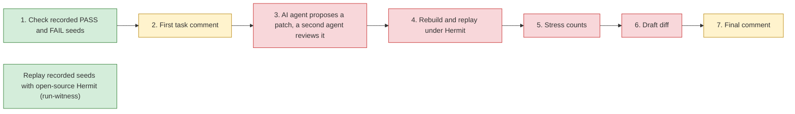

# State of the 22-diff TFA prototype stack (as of 2026-09-28)

Read-only survey from devbig030. No diff was edited, published or commented on. Each number carries its
source in brackets or in a Sources column. "Inference" marks reasoning that no record proves. Summarized in
[README.md](README.md) section 5. Copies of the cited non-repository files are in [evidence/](evidence/);
[evidence/MANIFEST.md](evidence/MANIFEST.md) maps each copy to its original path.

Terms used here:

- **Publish**: make a draft diff visible for review. **Land**: commit it to fbsource master.
- **CI signal**: one automated check (usually one test in one build mode) that Phabricator runs.
- **Land-blocking warning**: a CI failure that Phabricator says blocks landing, even though the same
  test also fails on the parent revision.
- **Containment tests**: the stack's suite `tfa_production_containment_test`, which checks that an AI
  agent and Hermit stay inside a sandbox (sudo-mounted Btrfs scratch space, systemd units).
- **Witness replay**: re-running a recorded Hermit seed that should make a test PASS or FAIL.

## 1. The 22 diffs

All 22 are Unpublished drafts under the owner's account. They form one linear chain (each depends on
the one above it). None has a reviewer, a subscriber or a human comment [A]. The CI column is
passed / warnings / failed, out of all signals, for each diff's latest version [B]. "Agent tag" is the
who-am-i tag found in the title or summary [A].

| # | Diff | Title (Phabricator) | Lines +/− | Files | CI | Agent tag | What it adds |
|---|---|---|---|---|---|---|---|
| 1 | D121244476 | Add bounded phase-two prototype | +5,221 / −0 | 19 | 156 / 2 / 0 of 160 | none | Base package: a manifest of the 3 tests, a 7-stage state machine, draft-only diff and dry-run comment gates |
| 2 | D121244213 | Use native Codex sandbox with TFA lifecycle control | +18,935 / −1,203 | 24 | 307 / 0 / **28** of 340 | none | Runs Codex agents in a sandbox; adds a reviewer agent, packaged safehermit, Hermit replay and the containment tests |
| 3 | D121649569 | Close controller follow-up contracts | +1,108 / −49 | 2 | 315 / 28 / 0 of 344 | Codex-family agent | Fixes three gaps found by a real run on 2026-09-23 |
| 4 | D121848885 | Make controller dependencies self-contained | +730 / −6 | 8 | 333 / 28 / 0 of 363 | Codex-family agent | Switches replay to the packaged fbsource Hermit (recorded as blocked); rejects blocked Codex versions |
| 5 | D121848886 | Close phase-two review findings | +1,378 / −191 | 12 | 344 / 0 / **32** of 378 | gpt-5.6-sol | Hermit import receipts; refuse unqualified Hermit and Codex; recover test fixtures |
| 6 | D121848888 | Seal Codex incompatibility provenance | +567 / −59 | 5 | 361 / 34 / 0 of 399 | tfa-phase2-cyber-opus | Binds Codex launcher, manifest and channel; records Codex 0.156.0 and 0.156.1 as blocked |
| 7 | D121848889 | Hash-bind the Codex payload and unify deadlines | +1,036 / −92 | 6 | 414 / 32 / 0 of 450 | tfa-phase2-cyber-opus | Adds the Codex payload hash and a single deadline origin |
| 8 | D121848890 | Refuse empty wrapper argv; byte-bind Hermit test | +127 / −21 | 3 | 421 / 30 / 0 of 454 | tfa-phase2-cyber-opus | Two small review fixes |
| 9 | D121848892 | Render deterministic difference hints and unposted initial comments | +431 / −4 | 5 | 436 / 30 / 0 of 468 | tfa-phase2-cyber-opus | `render-evidence`: a PASS-versus-FAIL log diff and an unposted first comment |
| 10 | D121848893 | Lead unposted initial comments with measured non-/tmp reproducers | +624 / −23 | 5 | 450 / 31 / 0 of 484 | tfa-phase2-cyber-opus | The first comment leads with commands re-measured outside `/tmp` |
| 11 | D121848894 | Bind censored relocation attempts and resolve relocated paths | +222 / −28 | 4 | 455 / 32 / 0 of 491 | tfa-phase2-cyber-opus | Hardens the checks on those re-measured commands |
| 12 | D121848895 | Bind relocated safehermit reports to unique keys and the manifest Hermit | +44 / −5 | 3 | 455 / 28 / 0 of 486 | tfa-phase2-cyber-opus | Refuses repeated report keys and an unexpected Hermit hash |
| 13 | D121848896 | Render unposted candidate-fix follow-ups from re-judged witness replays | +658 / −8 | 5 | 463 / 31 / 0 of 496 | tfa-phase2-cyber-opus | `render-followup`: judges unfixed versus patched replays as SUPPORTED, NOT SUPPORTED or INCONCLUSIVE |
| 14 | D121848898 | Bind the follow-up unfixed phase to the manifest test ELF | +21 / −6 | 3 | 476 / 31 / 0 of 510 | tfa-phase2-cyber-opus | Closes a gap where unfixed and patched runs could be swapped |
| 15 | D121848525 | Render follow-up root causes as caveated hypotheses | +356 / −7 | 4 | 490 / 31 / 0 of 524 | tfa-phase2-cyber-opus | Shows the root cause as a ranked hypothesis |
| 16 | D121877477 | Hash-bind every follow-up artifact in the ledger | +472 / −96 | 6 | 488 / 31 / 0 of 521 | none | The run ledger records 8 kinds of artifact by hash |
| 17 | D121877478 | Bind follow-up replay roles to manifest seeds | +155 / −13 | 3 | 493 / 31 / 0 of 526 | none | Ties each replay to its recorded seed |
| 18 | D121877479 | Keep task comments dry-run-only | +139 / −11 | 5 | 501 / 30 / 0 of 532 | none | Refuses every posting authorization |
| 19 | D121877480 | Present the final comment's cause as an unproven hypothesis | +68 / −4 | 4 | 502 / 30 / 0 of 533 | none | Wording |
| 20 | D121877481 | Exercise the eligible Codex launch with a hash-bound fixture | +576 / −12 | 4 | 506 / 33 / 0 of 540 | none | A test-only "eligible" Codex stand-in; real-Codex tests skip on the blocked release |
| 21 | D121978134 | Pin the rolled-over owner-managed Codex releases as blocked | +24 / −23 | 4 | 506 / 30 / 0 of 538 | none | Re-pins new Codex digests, still blocked |
| 22 | D121978137 | Add a separately labelled external OSS Hermit prototype mode for witnesses | +1,657 / −6 | 4 | 528 / 30 / 0 of 559 | none | `run-witness` with the preserved open-source Hermit binary (commit 4630ee2a) |

"Codex-family agent" is the tag `unknown-agentname / codex-family-by-ancestry`. `tfa-phase2-cyber-opus`
ran the model `claude-opus-5-5`. All tagged agents ran on devbig030 [A].

**Totals** (recomputed by summing `lines_added` and `lines_removed` over the 22 saved
`meta phabricator.diff files --number D<N> -o json` outputs in `/tmp/sub-tfa2-030/gather/stackstate-raw/files-D*.json`;
copies in [evidence/gather-raw/stackstate-raw/](evidence/gather-raw/stackstate-raw/)):

| Measure | Value |
|---|---|
| Lines added / removed | +34,549 / −1,867 |
| Changed lines (added + removed) | 36,416 |
| Net lines = size of the final tree | 32,682 (matches `wc -l` of the stack-tip copy [C]) |
| Distinct files | 33, all new, all under `fbcode/testinfra/tfa/` |
| Test lines (net, under `tests/`) | 16,181 (49.5%) [C] |
| Non-test lines (net) | 16,501, of which 13,555 are Python [C] |
| Largest diff | D121244213: 20,138 changed lines, 55% of the stack |
| Versions | 43 across the 22 diffs; D121244213 has 6 [A] |

By purpose (inference from titles and summaries [C]): 6 diffs add something a user can run (rows 1, 2, 9, 10,
13 and 22). One adds a test stand-in (row 20) and one re-pins digests (row 21). The other 14 add checks, hashes,
refusals or wording.

## 2. What the code does at the tip

Green works. Yellow runs as a dry run only (it never posts). Red is refused or unreachable [D]:

- Stage 3 refuses because every pinned Codex version is marked blocked (`process.py:104-121`).
- Stages 4-5 refuse because the packaged fbsource Hermit fails its provenance check (`hermit.py:1769-1828`,
  reached from `main.py:41-64, 282, 374`). The packaged Hermit also failed 8 of 8 qualification runs on
  2026-09-24 [E].
- Stage 6 is unreachable because stages 3-5 are blocked.
- Comments never post: `comments.py:287` always refuses.
- `run-witness` with open-source Hermit works on devbig030 only. It needs a binary under
  `/home/newton/work/dev-hermit/ignored/`, test binaries in `/home/newton/work/tfa/fbsource/buck-out`,
  and a sudo-mounted Btrfs scratch space [E].
- There is no test discovery or scheduling (`README.md:3-4`).

Note: the three candidate test fixes behind the stack's SUPPORTED verdicts were written by Claude agents
and replayed by a separate shell script, not by stages 3-5 [F]. A real run of the full flow on
2026-09-23 did reach a qualified report for thrift before these blocks were added; only its audit file
survives (`/tmp/tfa-phase2/goal-20260923.CQi0pX/controller-followup-audit.md`; copy
[evidence/tmp-tfa-phase2/goal-20260923.CQi0pX/controller-followup-audit.md](evidence/tmp-tfa-phase2/goal-20260923.CQi0pX/controller-followup-audit.md)) [E].

## 3. Where it lives

| Item | Location and status | Source |
|---|---|---|
| Diffs | Phabricator, Unpublished; `is_landable=False`; land blocker `latest_phabricator_version_is_draft` | [A] |
| Code path | `fbcode/testinfra/tfa/`. **Not on fbsource master.** `sl files -r remote/master fbcode/testinfra/tfa` returned rc 1 at master `9e6ec042287d` (2026-09-28 11:14 PDT); a control path returned rc 0. BigGrep finds no TFA symbols. | [A] |
| Base | Forked from public `4c52f205ae7a` (2026-09-22 02:55 PDT), 6 days behind master. D121244476 carries a land-blocking "Old Diff" warning. | [A] |
| Local commits | `/home/newton/fbsource` on devbig030: all 22 are phase draft. The tip `317d325e8eb0` differs from Phabricator's recorded `a729ddf3707f` only in the commit message (`sl diff` of the two is empty). | `sl log -r '6b3a2263c23c::317d325e8eb0' -T '{node\|short} {phase} {phabdiff}\n'` [A] |
| devvm895 copy | A previous agent reported the tip there as phase "secret". That is a separate repository and cannot be checked from devbig030. | [A] |
| Stack-tip source copy | `/tmp/sub-tfa2-030/devvm895/tfa-src/fbcode/testinfra/tfa/` (not durable; not copied here). The per-diff summaries from the same copy are in [evidence/devvm895/STACK_SUMMARIES.md](evidence/devvm895/STACK_SUMMARIES.md) | [C] |
| Run evidence | Untracked: `/home/newton/work/tfa/` (named subdirectories), and `worktrees/slots/tfa-phase2-cyber-opus/ignored/tfa-phase2-three-case/` and `.../tfa-phase2-evidence/` in dev-hermit | [E] |
| Hard-wired inputs | Exactly 3 tests (`manifest.py:249-277`); `argv[0]` must be `/home/newton/work/dev-hermit/bin/safehermit` (`manifest.py:193`); guest directories under `/tmp/tfa-phase2/` (`manifest.py:18-22`); oncall `testinfra` (`BUCK:16`); comments as the AutoTestRemediation bot `4533519350210414` (`comments.py:21`) | [D] |

Who made it: the owner's account authored all 43 versions. 13 diffs carry an agent's tag. The other 9
have none, and the records cannot show whether the owner submitted any of them by hand [A]. The only
other actors are bots: 48 automated comments, all unresolved (32 ShellCheck notes on
`resources/safehermit` in D121244213, and 16 AI-reviewer notes across 12 diffs), plus 5 AI-review
transactions [A].

## 4. Local build and test results

| When (PDT) | Host | What ran | Result | Source |
|---|---|---|---|---|
| 2026-09-24 18:04-18:05 | devbig030 | Unit and containment tests at `68cf2bac` | Unit 132/132; containment 36/40 (4 real-Codex failures) | `/tmp/tfa-phase2/unit-68cf2bac-recheck.out`, `/tmp/tfa-phase2/production-full-68cf2bac-recheck.out` ("Pass 36. Fail 4"); failure text in `/tmp/tfa-phase2-production-final.out` (an earlier run, Pass 35, Fail 4); copies in [evidence/tmp-tfa-phase2/](evidence/tmp-tfa-phase2/) [E] |
| 2026-09-25 13:43-15:07 | devbig030 | Mutation testing of 5 review fixes (one code change per run, test must fail) | 49 of 49 mutants caught | `/home/newton/work/tfa/mutant-*.log`, `mut-*.log` [E] |
| 2026-09-25 19:52-20:00 | devbig030 | Full `buck test testinfra/tfa/...` for D121978134 | Pass 249, Fail 0, Skip 4, Omit 1; 494 s | `/home/newton/work/tfa/codex-rollover/full-test.log` line 45 (timestamps 19:51:44 to 19:59:58; copy [evidence/tfa-lane/codex-rollover/full-test.log.txt](evidence/tfa-lane/codex-rollover/full-test.log.txt)); the 494 s is from `/home/newton/work/tfa/codex-rollover/testplan.txt` line 13 (copy [evidence/tfa-lane/codex-rollover/testplan.txt](evidence/tfa-lane/codex-rollover/testplan.txt)). The whole codex-rollover lane ran 19:29-20:10 |
| 2026-09-26 00:16 | devbig030 | Mutation testing at D121978137's submitted head | 67 caught, 5 missed; the lane's own note calls 2 of the 5 a "real test gap". The test plan does not mention this. | `/home/newton/work/tfa/external-oss-mode/mutants-head6/SUMMARY.txt`, `DISK-HOLD-4fb8c4120739.txt` (copies under [evidence/tfa-lane/external-oss-mode/](evidence/tfa-lane/external-oss-mode/)) [E] |
| 2026-09-26 09:06-09:15 | devbig030 | D121978137 test plan: containment tests, then 6 witness replays | Containment Pass 39, Skip 4 (the 4 blocked-Codex tests), 316 s. Replays: 8 of 8 steps rc 0 in 210 s, all expected PASS/FAIL. The previous attempt timed out on the HTTPCoro FAIL replay at the 120 s limit. | `/home/newton/work/tfa/external-oss-mode/D121978137-test-plan.txt` lines 3-7 (copy [evidence/tfa-lane/external-oss-mode/D121978137-test-plan.txt](evidence/tfa-lane/external-oss-mode/D121978137-test-plan.txt)) |
| 2026-09-28 11:15-11:20 | devvm895 (agentcloud short-lease devvm) | Containment tests | Pass 37, Fail 6: 5 "Codex release manifest identity differs", 1 "No space left on device" in `test_current_full_trace_refuses_trace_drift_and_cleans_up` | `/tmp/sub-tfa2-030/devvm895/tfa-diag/containment-local.log` line 255 (copy [evidence/devvm895/containment-local.log.txt](evidence/devvm895/containment-local.log.txt)) |
| 2026-09-28 | devvm895 | Build, and 215 unit tests | Reported as rc 0 and 215/215 by a previous agent. **No log was kept; unverified.** CI independently shows the 215 unit tests passing on D121978137. | [A] |

The Codex pins are stale again on devbig030. D121978134 pinned launcher `d22c52fa…`, stable
`4b776a3e…` and latest `d291f08a…`. On 2026-09-28 the host has launcher `2d4083cf…` (installed
2026-09-27 23:30), stable `d291f08a…` and latest `7e520ac7…` (`sha256sum /usr/local/bin/codex_cli/*`) [E].
Inference: the 4 tests that skipped on 2026-09-26 would now fail locally, as they do on devvm895.

## 5. CI signals

### Top two diffs

| Diff | Passed | Warnings | Failed | Info | Total |
|---|---|---|---|---|---|
| D121978134 | 506 | 30 | 0 | 2 | 538 |
| D121978137 | 528 | 30 | 0 | 1 | 559 |

Source: `/home/newton/.llms/skills/claude-templates/ci-signals/scripts/check_ci_state D<N>` [B]. The 30
warnings on each are 15 containment tests times 2 build modes (dev and opt). All 30 are land-blocking,
and all 30 also fail on the parent revision
(`meta phabricator.diff.signals list --number D1219781{34,37} --status=warning --details --limit=500 -o json`) [A].
The 215 unit tests (`tfa_phase2_test`) pass in both modes on D121978137 [A].

Sandcastle runs behind those signals (`testx --caller ci-signals --as-json results list <run>`) [A]:

| Run | Diff, mode | Duration | Passed / failed |
|---|---|---|---|
| 1125900439774673 | D121978137, dev | 415 s | 249 / 15 |
| 17732923738240851 | D121978137, opt | 384 s | 245 / 15 |
| 34058472220695225 | D121978134, dev | 381 s | 240 / 15 |
| 14073749038122421 | D121978134, opt | 374 s | 236 / 15 |

### The 15 failing containment tests, grouped by cause

| Cause | Count | Tests |
|---|---|---|
| Sandcastle user `twsvcscm` may not run `sudo -n mount -o loop` for the Btrfs scratch image | 9 | `test_current_full_trace_cannot_qualify_minimal_guest_and_cleans_up`, `test_current_full_trace_refuses_trace_drift_and_cleans_up`, `test_forced_run2_kill_confines_and_seals_verify_residue`, `test_inflight_bounded_commands_hold_recovery_until_quiescent`, `test_killed_controller_recovers_every_verify_allocation_boundary`, `test_nested_hermit_lock_serializes_independent_processes`, `test_removed_worktree_drain_rejects_real_deleted_process_root`, `test_runtime_recovery_preserves_mounted_interrupted_staging`, `test_worker_response_timeout_keeps_command_lock_until_exit` |
| systemd unit `chataccd-mount@<hash>.service` not found on the CI host | 1 | `test_killed_worktree_body_is_reconciled_by_independent_owner` |
| "Codex stable (or latest) release manifest identity differs": the installed Codex no longer matches the pins | 5 | `test_real_codex_bootstraps_with_bound_agent_identity` (latest), `test_real_codex_candidate_handoff_uses_controller_buck`, `test_real_codex_final_message_cannot_be_redirected_by_tool`, `test_real_codex_native_workspace_sandbox_and_tfa_cleanup`, `test_real_codex_reviewer_final_message_cannot_be_redirected` |

9 of the first 10 are CI-only: they passed on devvm895, an agentcloud short-lease devvm. The 10th,
`test_current_full_trace_refuses_trace_drift_and_cleans_up`, ran there but failed with ENOSPC ("No space
left on device"; section 4) [A; `evidence/devvm895/containment-local.log.txt`]. One caveat on "also fails on the parent": for
D121978134 in dev mode, the 5 Codex tests failed on the parent for a different reason ("version command
could not start"), at 75-86% similarity, not the 98-99.9% seen elsewhere [A].

### The two red diffs in the middle

- **D121244213: 28 failed** = 14 containment tests times 2 modes (9 sudo mount, 1 systemd unit, 4 real
  Codex with older errors). They count as real failures because the tests were added in this diff, so
  CI cannot excuse them as failing on the parent [A].
- **D121848886: 32 failed.** 26 also fail on the parent but are still marked failed. 6 were added in this
  diff: two Btrfs tests times 2 modes, and the unit test
  `test_real_packaged_hermit_is_bound_to_blocked_provenance` times 2 modes ("packaged Hermit compatibility
  is PROVENANCE_MISMATCH"). That unit test passes by D121978137; which diff fixed it was not traced [A].

## 6. What publishing or landing would require

Nothing here has been started, and no diff is published, landed, abandoned or given reviewers without an explicit owner instruction. Items 1-4 are needed before a useful review; 5-10 before a land.

1. **An owner and a home.** The code names `testinfra` as oncall and borrows the AutoTestRemediation bot
   (owned by `billing_experiences_customer_success`); no record of either team's agreement was found [D].
   Remove both or get agreement.
2. **Reviewers.** None today. 36,416 changed lines is a large review; D121244213 alone is 20,138.
3. **Answer the 48 bot comments** (32 ShellCheck, 16 AI reviewer), all unresolved [A].
4. **Fix the commit-message drift.** D121244213's local message ("Bind fatal witnesses and SafeHermit
   evidence") differs from its title; D121848885's title field contains the agent tag and part of the
   summary [A].
5. **Rebase onto current master.** The base is 6 days old and D121244476 has a land-blocking "Old Diff"
   warning. A rebase will likely re-run CI against newer Codex digests (inference).
6. **Make every diff green on its own.** D121244213 (28 failed) and D121848886 (32 failed) must pass, or
   the stack must be squashed.
7. **Clear the 15 land-blocking tests per mode.** The 9 sudo and 1 systemd tests need a CI lane with
   passwordless sudo and Btrfs (for example a VM test lane), or must be marked local-only. The 5 Codex
   tests need a signed Codex that contains the fix `18cdc3ab303f`; the current `codex_latest` is built
   from `24281a08`, which predates it [E]. Or drop Codex.
8. **Unblock Hermit replay.** fbsource's Hermit is the 2026-07-25 import of `a919cce` and fails
   qualification. The pending import attempt, D120908510, is an unpublished 16-line stub built from
   https://github.com/facebookexperimental/hermit/pull/93 (head `4dcb34b4`), which lacks the RLIMIT_CORE
   fix. That fix landed on rrnewton/hermit main through https://github.com/rrnewton/hermit/pull/3142. The
   import must be refreshed to current rrnewton/hermit main and re-qualified. A separate counter-skid
   failure (HTTPCoro) may be https://github.com/rrnewton/hermit/issues/1845 (inference) [G].
9. **Remove the hard-wiring** listed in section 3: the 3 fixed tests, `/home/newton` paths, `/tmp/tfa-phase2`
   directories (which conflict with the owner's no-`/tmp` rule), and byte-pinned binaries on one host.
10. **Close the 2 known test gaps** from mutation testing (`reseal-metadata-file`, `reseal-identity`) [E].

Given this list, `WAY_FORWARD.md` recommends not publishing the stack, and building a small new loop
instead.

## Sources

- [A] `/tmp/sub-tfa2-030/gather/stackstate.md` (copy [evidence/gather-stackstate.md](evidence/gather-stackstate.md)), built from `meta phabricator.diff
  {describe,files,reviewers,comments,history,versions,agent-activity} --number D<N> -o json`,
  `meta phabricator.diff stack-ci --number=D121978137 --output=json`,
  `meta phabricator.diff.signals list ...` and `testx ... results list <run>`, with raw outputs in
  `/tmp/sub-tfa2-030/gather/stackstate-raw/` (3.1 MB; only the `files-D*`, `cistate-D*` and `sl-*` outputs used for
  the totals and CI counts are copied, to [evidence/gather-raw/stackstate-raw/](evidence/gather-raw/stackstate-raw/)).
- [B] `/tmp/sub-tfa2-030/gather/stackstate-raw/cistate-D<N>.json` (copies in [evidence/gather-raw/stackstate-raw/](evidence/gather-raw/stackstate-raw/)), from
  `/home/newton/.llms/skills/claude-templates/ci-signals/scripts/check_ci_state D<N>`; re-read 2026-09-28
  (verdict RED for D121244213 and D121848886, GREEN with warnings for the other 20).
- [C] `/tmp/sub-tfa2-030/gather/phase2.md` §1 (per-diff purpose, `wc -l` of the stack-tip copy); copy
  [evidence/gather-phase2.md](evidence/gather-phase2.md).
- [D] Stack-tip source in `/tmp/sub-tfa2-030/devvm895/tfa-src/fbcode/testinfra/tfa/` at the cited lines;
  `/tmp/sub-tfa2-030/gather/wayforward.md` §1 rows 9-10, 16-23 (copy [evidence/gather-wayforward.md](evidence/gather-wayforward.md)).
- [E] `/tmp/sub-tfa2-030/gather/phase2.md` §2-§4, which reads the named files under `/home/newton/work/tfa/`,
  `/tmp/tfa-phase2/`, and the untracked evidence trees in `worktrees/slots/tfa-phase2-cyber-opus/ignored/`. Copies of the
  small files: [evidence/tfa-lane/](evidence/tfa-lane/), [evidence/tmp-tfa-phase2/](evidence/tmp-tfa-phase2/).
- [F] `worktrees/slots/tfa-phase2-cyber-opus/ignored/tfa-phase2-three-case/RESULTS.md` §2.2-2.3 (untracked; copy
  [evidence/phase2-three-case-RESULTS.md](evidence/phase2-three-case-RESULTS.md)).
- [G] `/tmp/sub-tfa2-030/gather/wayforward.md` §0.1 (GitHub queries saved as
  `/tmp/sub-tfa2-030/gh-wayforward-{1,3,7,8}.json`, copies in [evidence/gh/](evidence/gh/)); `sl log fbcode/hermetic_infra/hermit/hermit-cli/src/bin/hermit/main.rs`
  (import `5a90c83fbd90`, 2026-07-25, D113553943).
